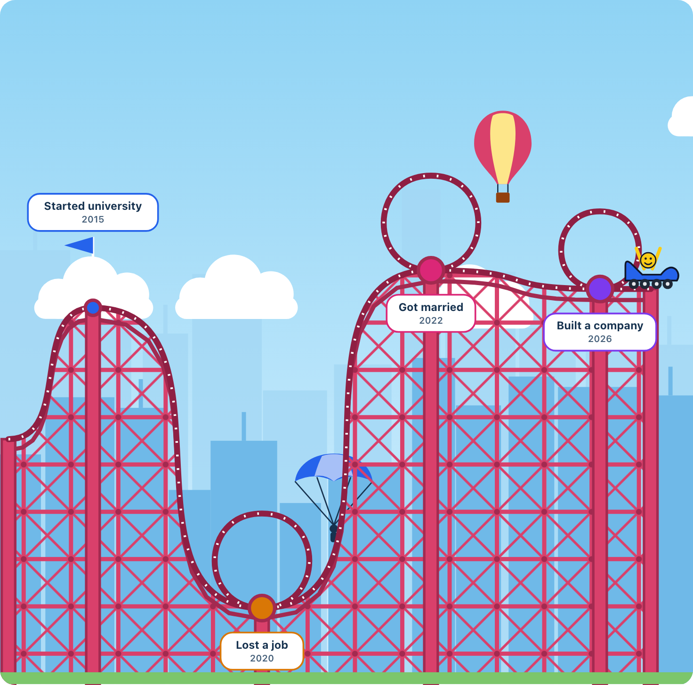

# Lifecycle Roller Coaster

[](https://github.com/UttyWotty/lifecycle-roller-coaster/actions/workflows/ci.yml)
[](LICENSE)

**Your life is a journey. Let's see what the ride looks like.**

Write your life story in your own words, and the AI turns it straight into a roller coaster. The highs climb, the lows drop, and the quiet years run flat. Adjust anything that does not feel right, then download your ride as an image.



This is a playful, creative picture of a story. It is not a psychological assessment or a measurement of anyone's life.

## Features

- **Free-form writing:** no questionnaire and no account. Just tell your story.
- **AI event extraction:** Claude finds the events, dates, categories and feelings in your text. It does not invent events, and it asks about anything unclear.
- **From text to ride in one step:** you do not have to fill in any forms.
- **You have the final say:** editing is optional, and you can change, add, delete and reorder every event. AI guesses are labelled there until you confirm them.
- **No AI required:** skip it and add your events by hand.
- **An adjustable ride:** select a stop and change how it felt or how much it mattered, and the track redraws at once.
- **Ride styles:** draw your life as the classic coaster, with loop-the-loops at every big moment, or as a metro map with a line for each part of your life. Not sure which? **Random ride** picks a surprise style, theme and character in one press, and every look is redrawn from the same events, so no AI runs again.
- **Art modes:** completely different looks for your ride. Classic Ride is a soft pastel toy, Nightmare Mode a glowing neon city, Minimal Mode black line art, Retro Mode a vintage poster, Comic Book a comic strip with speech bubbles and POW bursts, 8-Bit Life a daytime pixel adventure with LEVEL UP and CHECKPOINT banners, Dreamland a puffy balloon ride floating on clouds under rainbows, Watercolor a pen-and-wash painting on textured paper, Building blocks a toy-brick model on a studded baseplate, Surreal dream a quiet dream plain with floating boulders and long shadows, Track map a minimalist ride poster with a spec sheet of your ride, and Isometric model a small 3D model on a tiled slab.
- **Worlds:** tell your story as a Space mission, Ocean voyage, Mountain trek, Arcade level, Growing garden, Your constellation, River trip or Storybook, each with its own vehicle. In the Growing garden your life is a vine on garden canes: good moments bloom into flowers, hard ones grow thorns, calm ones sprout leaves, the ground changes season with each chapter, and a ladybug carries your rider. In Your constellation every moment is a star, bigger for bigger moments, gold, blue or white by feeling, each chapter is its own figure of stars, and a comet carries your rider. On the River trip your life is a river through green banks: steep stretches run as white-water rapids with a splash below each big drop, calm stretches carry lily pads and reeds, and you paddle a canoe. In the Storybook your life is a paper theatre in a picture book: every chapter is its own page, each stop hangs on a thread from a paper garland over cut-paper hills and clouds, the track is a stitched ribbon, and a paper aeroplane carries your rider.
- **Life Chapters and Life Report:** Claude names the eras of your life and writes a short, playful report in the same reading of your story.
- **Life Statistics:** your biggest comeback, biggest drop and longest steady stretch, worked out from your events with no AI.
- **Share your ride:** Share my ride sends a story-sized picture (1080 by 1920, for phone stories) with your ride's title, years and a link to the ride through your device, or copies the picture. Download image saves the wide drawing, and **Download poster** saves a print-ready A3 landscape poster (about 290 dpi) with the title, years and the whole ride, for framing or a gift. **Make a ride video** records a portrait video (1080 by 1920) of the cart riding your life with its sounds, each stop captioned and an ending card, ready for Reels, TikTok or WhatsApp. It records on your device in real time, as MP4 where the browser can and WebM otherwise. Or share a link: one tap posts it to X, WhatsApp, Telegram or email, or your phone's share sheet. Whoever opens it can take the ride, then make their own. **Copy embed code** gives a snippet to paste into a blog or website, which shows your ride there with Ride it; the ride travels in the snippet's link, so no server stores it. Nothing is shared unless you choose to.
- **Illustrated themes:** a full scene with sky, skyline, steel lattice and flags, in Sunny day, Golden sunset, Starry night, Retro fairground or Haunted night. A cart rides the track, and a balloon and parachute mark your best and hardest moments.
- **Sample lives:** try a random made-up life in one click, with nothing to write and no API key.
- **Your title:** name your ride, and the title appears on the drawing and in the image.
- **Choose your character:** pick who rides your cart, from six original characters.
- **Ride it:** press Ride it and the cart rides your life stop by stop while the view follows it. Each stop shows its story, climbs are slow and drops are fast, and the ride ends on your life report. Pause, step back and forward, or exit, with buttons or keys. Turn on **Sound** for a click-clack up every climb, a whoosh down every drop, a chime at the highs, a low note at the lows and a fanfare at the finish. Sound starts off, is made in your browser with no audio files, and your choice is remembered on this device. Turn on **Music** for a short looping tune that suits your theme, from a music box to an arcade chiptune, written in code with no audio files; it also plays under ride videos. Turn on **Narrate** and your device's own voice reads each stop's date and title as the cart reaches it (nothing is downloaded or sent anywhere; ride videos are not narrated, since browsers cannot record their own voice). Turn on **Non-stop** and the cart rolls through every stop without pausing, only slowing a little as it passes; ride videos follow the same choice.
- **Future stops:** press Add a future stop for something you are looking forward to, or give any event a date after today. Stops still to come sit past a dashed TODAY line on a softly veiled stretch of track, the cart parks at today, Ride it ends there with a list of what is coming, and statistics count only what has happened.
- **Ride lenses:** turn one story into several rides, such as My Career Coaster, My 2010s or My Life Before 30. Add the year you were born for age lenses. A ride you have not named takes the lens's title, ready to share.
- **Guess my ride:** on a ride someone shared with you, press Guess my ride. The track ahead hides behind a curtain; for each stop you see its title and date, guess how it felt and how big it was, and the curtain lifts to show the answer. At the end you get a score and can share it with the ride's link, so friends can try to beat it.
- **Ride together:** open a friend's ride link and press Ride together with my ride, or paste their link on your own ride. Your two lives appear on one timeline, with the same years lined up, both carts ride through time side by side, and "The same year, two stories" lists the years you both had big moments. The pair has its own link to share. On a ride together, **Add a friend's ride** brings in another ride link, for a family or group of up to four.
- **Languages:** pick English or Turkish in the footer; a Turkish browser gets Turkish automatically. The AI writes your events and report in the language your story is written in.
- **Saved on your device:** your ride is still there when you come back. **My rides** keeps up to 12 rides, such as your life, your career or a parent's story: start a **New ride**, open another, or delete one. Your story text is never saved, and Start over deletes the ride that is open.
- **A calm ride screen:** at first you see your ride and Ride it. Everything else is one tap away: **Edit**, **Random ride**, **Ride options** (Sound, Music, Narrate, Non-stop, Ride again), **Make it yours** (style, theme, character, name and lens), **Share** (images, poster, video, link, embed, Ride together) and **More about your ride** (statistics). Your own ride remembers which ones you left open; a shared ride's page stores nothing.
- **Send feedback:** a link in the footer, and at the end of the ride screen, opens a short form: how was it, plus an optional message. Only your choice, your words, the language and the day are kept; your story, events and who you are are never sent with it.
- **Fit to screen:** an optional toggle that shows a whole long ride at once, instead of scrolling sideways.
- **Image export:** download a PNG that is created on your device.

## Getting Started

To run it on your own machine you need Node.js 24 or later. To host it publicly, see [Deploying](#deploying).

```bash
git clone https://github.com/UttyWotty/lifecycle-roller-coaster.git
cd lifecycle-roller-coaster
npm install
cp .env.example .env
npm run dev
```

Then open http://localhost:3000. Choose **Try a sample life** to see a finished ride straight away, with no key needed.

### Demo mode and real stories

The app starts in demo mode, so Generate ignores what you wrote and returns the same four sample events, with a clear notice on the review screen. This costs nothing, and lets you try the app without a key.

To have Claude read real stories, edit `.env`:

```bash
ANTHROPIC_API_KEY=your-key-here
EXTRACTOR_MODE=anthropic
```

You need your own [Anthropic API key](https://console.anthropic.com/). With the default model, Claude Sonnet 5.5, a short story of a paragraph or two costs about 1.5 cents, including its chapters and report (about 2,500 input and 1,000 output tokens). Each extraction logs its token count to the server console.

Keep your key safe: `.env` is git-ignored, so never commit it, and never prefix its values with `NEXT_PUBLIC_`, because that would send them to the browser.

| Setting | Default | Purpose |
| --- | --- | --- |
| `EXTRACTOR_MODE` | `anthropic` in code, `fixture` in `.env.example` | `fixture` returns demo events, and `anthropic` calls the API |
| `ANTHROPIC_API_KEY` | none | Your API key, needed only for `anthropic` mode |
| `ANTHROPIC_MODEL` | `claude-sonnet-5-5` | The Claude model to use |

## How the Ride Is Drawn

Each event has a **sentiment** and an **impact** from 1 to 10, which are separate because a neutral event can still matter a lot.

- Positive events sit above the middle, higher the more they mattered.
- Negative events sit below the middle, lower the more they mattered.
- Neutral events keep the track flat.
- Events with an impact of 8 or more get a larger marker.

Height comes from each event's own points, so a 10 followed by a 1 is a sharp drop and a 1 followed by a 10 is a sharp climb, and the bigger the gap, the steeper the move. Stops sit in the order of your list, and the space between them follows the time between their dates: two moments in the same year sit close together, and a five-year gap is wider. Long gaps are capped, so one quiet decade never stretches the ride, and undated events keep a normal gap.

On a metro map, each category is its own line. A stop sits above its line when it felt good and below when it felt hard, and every line meets at events with an impact of 8 or more.

## Privacy

Life stories can be personal, so the app is built to hold on to as little as possible.

- Nothing leaves your browser until you press Generate. The page tells you this before you do.
- In `anthropic` mode, pressing Generate sends your story to the Anthropic API. Anthropic's own data policies apply to that request.
- The app has no database of stories and no accounts. Your own rides (their events, chapters, report and look) are saved in your browser on this device only, up to 12 of them, so they are still there when you come back. The story text you typed is never saved; **Start over** deletes the open ride and **Delete** in My rides removes any of them. Sample lives are never saved.
- On the public site, a small counter store keeps how many readings each visitor started this hour and day, and the day's total spend. A visitor is a keyed one-way hash of their network address, never the address itself, and every counter deletes itself within two days.
- The public site counts page views with Vercel Web Analytics: which page was opened, the country, browser and device type. It uses no cookies and identifies no one. Before anything is sent, the address is cut down to the site and page, so the ride in a shared link (after "#") never reaches Vercel. Nothing is counted in previews or local runs.
- The server never logs story content, only error codes and token counts.
- Images are created on your device and are never uploaded. They contain titles, dates and markers, but not descriptions or your story.
- Nothing is ever shared unless you choose to share it. A share link packs the ride into the part of the link after "#", which browsers never send to a server, so shared rides are not stored anywhere. It holds event titles, dates, feelings, sizes, categories, chapter names, the title and the look. Descriptions, the life report and your story are never put in a link.

## Architecture

A single Next.js app, with TypeScript, Tailwind CSS, zod and hand-drawn SVG.

```text
Story text --> POST /api/extract --> Provider adapter --> Validated events
                                                                |
                 Manual entry --> event editing ----------------+
                                                                v
                                     buildTrack --> Ride stage --> PNG export
                                                        ^
                                                        |
                                              Optional event editing
```

The AI layer and the rendering engine are independent. The AI produces structured events, and the track generator reads only those events, so changing the provider never touches the visuals, and manual events work with no AI at all. Lint rules enforce this boundary.

| Path | Contents |
| --- | --- |
| `src/app/` | Routes, the root layout and the extraction endpoint |
| `src/components/` | UI for the story, review and ride stages |
| `src/lib/ai/` | Provider-agnostic extraction and the Claude adapter |
| `src/lib/events/` | The shared event schema and pure editing logic |
| `src/lib/story/` | Pure rules for the story input |
| `src/lib/track/` | The pure roller-coaster track generator |
| `src/lib/export/` | Pure preparation of the ride image |
| `src/lib/ride/` | Pure timing and geometry for Ride it playback |
| `src/lib/lenses/` | Pure ride lenses: parts of life, decades and ages |
| `src/lib/share/` | Pure share-link encoding and social share URLs |
| `src/lib/together/` | Pure Ride together: lining two to four rides up in time, and the group link |
| `src/lib/saved/` | Pure shape of the rides saved on the device (one ride, and the shelf of up to 12) |
| `e2e/` | Browser tests for the full user journey |
| `docs/` | The product blueprint |

To add a provider, implement the `EventExtractor` interface in `src/lib/ai/extractor.ts`.

## Development

| Command | Purpose |
| --- | --- |
| `npm run dev` | Start the development server |
| `npm run build` | Create a production build |
| `npm start` | Serve the production build |
| `npm run lint` | Run ESLint |
| `npm run typecheck` | Generate route types and run the TypeScript compiler |
| `npm test` | Run the unit tests once, with no network or API key needed |
| `npm run test:watch` | Run the unit tests in watch mode |
| `npm run test:e2e` | Build the app and run the browser tests |

Browser tests need a browser, so run `npx playwright install chromium` once first. They always run in demo mode with an empty API key, so they never spend tokens, even if your `.env` holds a real key.

## Roadmap

The app covers the full path from story to image. Ideas for later releases include visual themes, life statistics, shareable links and a local-model option. See the [product blueprint](docs/lifecycle-roller-coaster-blueprint.md) for the thinking behind them, and the [changelog](CHANGELOG.md) for what has shipped.

## Contributing

Contributions are welcome. Branch from `develop`, keep each change focused, and open a pull request into `develop`. Lint, typecheck, tests and the build must pass, and CI checks them on every pull request. Please use demo mode for manual testing, and never include real personal stories in issues, tests or examples.

## Security

Please report vulnerabilities privately, as described in [SECURITY.md](SECURITY.md), rather than in a public issue. Every response carries a strict content security policy and refuses framing; the policy lives in `src/lib/security/securityHeaders.ts`.

## Deploying

The app runs on Vercel's free Hobby plan, with a free Upstash Redis database for its limits. Every real reading spends tokens on the host's Anthropic key, so the public site protects that key in four layers:

1. **Per visitor:** 5 readings an hour and 12 a day. After that the visitor sees a friendly message and can still explore sample lives.
2. **Daily budget:** a hard cap on spend across all visitors, $1 a UTC day by default (`DAILY_BUDGET_USD`). Each reading reserves its worst-case cost before calling Claude and settles to the real cost afterwards, so readings started at the same moment cannot overspend.
3. **Bot protection:** Vercel BotID (free Basic mode) blocks scripted requests before any tokens are spent.
4. **Fail closed:** on Vercel, if the limit store is missing or unreachable, Generate refuses to call Claude instead of spending unchecked.

Demo mode (`EXTRACTOR_MODE=fixture`) costs nothing, so it skips the limits.

### Step by step

1. **Make a separate API key with a spend limit.** In the [Anthropic Console](https://console.anthropic.com/), create a workspace for the public site, set a monthly spend limit on it (a little above 30 times the daily budget), and create an API key in that workspace. This is the last line of defence if everything else failed.
2. **Import the repository.** Sign in to [Vercel](https://vercel.com/) with GitHub on the free Hobby plan, choose **Add New → Project**, and import this repository. Leave the framework settings as detected.
3. **Set the production branch.** In **Settings → Environments → Production**, make sure the production branch is `main`, so only releases go live.
4. **Add the limit store.** In the project's **Storage** tab, add **Upstash for Redis** from the Marketplace on the free plan, connect it to the project, and let it add its variables. Under **Settings → Environment Variables**, confirm `KV_REST_API_URL` and `KV_REST_API_TOKEN` (or `UPSTASH_REDIS_REST_URL` and `UPSTASH_REDIS_REST_TOKEN`) are present.
5. **Add environment variables.** In **Settings → Environment Variables**:

   | Name | Value | Environments |
   | --- | --- | --- |
   | `ANTHROPIC_API_KEY` | the key from step 1 | Production only |
   | `EXTRACTOR_MODE` | `anthropic` | Production only |
   | `EXTRACTOR_MODE` | `fixture` | Preview and Development |
   | `DAILY_BUDGET_USD` | `1` | Production |

   Keeping the key out of Preview means preview deployments of pull requests can never spend tokens.
6. **Check a preview first.** Open any preview deployment, generate a ride, and confirm the demo reading appears. This proves BotID and the security headers work on Vercel at no cost.
7. **Deploy production.** Redeploy `main` (Vercel deploys it automatically on each release). Generate one real ride and check the function log for the token count.

8. **Turn on page counting (optional, free).** In the Vercel dashboard, open **Analytics**, select the project and press **Enable**, then redeploy `main`. The free plan counts up to 50,000 page views a month and pauses counting, never bills, if that runs out. The site only counts on the production deployment.

9. **Read feedback.** Messages from the feedback page are kept in the same Upstash database, newest first, in the list `lrc:feedback` (only the newest 500). In the Upstash console, open the database's **Data Browser** and select that key. Each entry holds the reaction, the message, the language, the day and the release, and nothing about who sent it. Sending is limited to 3 messages an hour per visitor and 200 a day in total, so the free plan cannot be used up.

To pause real readings at any time, set `DAILY_BUDGET_USD` to `0` and redeploy; sample lives keep working.

## License

[MIT](LICENSE)
